# ArcGIS Portfolio

Portfolio website for Samantha Galaviz Archila, focused on ArcGIS, web mapping, conservation, wildlife, and environmental project work.

The project is a Python FastAPI application that renders Jinja2 templates and serves static assets for styling and images. The home page includes a hero, about section, featured project carousel, selected work grid, contact bar, and footer. Projects have a portfolio listing and shared detail pages with optional interactive maps.

## Tech Stack

- Python
- FastAPI
- Jinja2 templates
- Pydantic models
- Bootstrap 5.3.3
- Font Awesome
- Custom CSS

## Project Structure

```text
.
|-- main.py
|-- api/
|   `-- index.py
|-- app/
|   |-- paths.py
|   |-- project_data.py
|   |-- models/
|   |   |-- component.py
|   |   |-- projects.py
|   |   `-- user.py
|   `-- routes/
|       `-- Init.py
|-- data/
|   `-- projects.json
|-- static/
|   |-- css/
|   |   `-- styles.css
|   `-- images/
|       |-- hero_bg.png
|       |-- otter_sprite.png
|       `-- profile.png
|-- templates/
|   |-- partials/project_card.html
|   |-- base.html
|   |-- index.html
|   |-- portfolio.html
|   `-- project.html
|-- tests/test_portfolio.py
|-- requirements.txt
|-- pyproject.toml
|-- vercel.json
`-- .python-version
```

## Current Pages

| Page | Route | Status | Notes |
| --- | --- | --- | --- |
| Home | `/` | Implemented | Uses `templates/index.html` with shared layout from `templates/base.html`. |
| About Me | `/#about` | Implemented | Navbar links to the existing homepage section. |
| Portfolio | `/portfolio` | Implemented | All projects from the validated JSON dataset. |
| Project | `/portfolio/{slug}` | Implemented | Description, images, and optional interactive map; unknown slugs return 404. |
| Resume | `/resume` | Planned | Omitted from navigation until implemented. |

## Local Setup

1. Use Python 3.12 or newer. Create and activate a virtual environment.

   ```powershell
   python -m venv venv
   .\venv\Scripts\Activate.ps1
   ```

2. Install dependencies.

   ```powershell
   python -m pip install -r requirements.txt
   ```

3. Run the development server.

   ```powershell
   uvicorn main:app --reload
   ```

4. Open the site.

   ```text
   http://127.0.0.1:8000
   ```

## Vercel Deployment

This repository is configured for Vercel's Python runtime. The FastAPI application
is exposed through `api/index.py`, and `vercel.json` routes all requests through
that function. Templates, JSON data, and static images are served by the
application.

1. Push the repository to GitHub and import it into Vercel.
2. Set the Vercel project **Root Directory** to the repository root.
3. Leave the **Build Command** and **Output Directory** empty. Vercel detects
   Python from `requirements.txt`; no frontend build is required.
4. Deploy with the Vercel dashboard or the CLI:

   ```powershell
   npx vercel
   npx vercel --prod
   ```

5. Verify `/`, `/portfolio`, a project detail URL, and a static image URL on the
   deployed domain. The application does not require environment variables.

Do not add `venv/`, `.content-review/`, caches, editor settings, or `.vercel/`
to the deployment. These paths are ignored by Git and are not needed at runtime.
Keep `app/`, `data/`, `static/`, `templates/`, `main.py`, `api/index.py`,
`requirements.txt`, `pyproject.toml`, `vercel.json`, and `.python-version`
tracked.

## Data Model

The application keeps portfolio data in Pydantic models:

- `User`: profile information, bio, about paragraphs, and projects.
- `Project`: unique slug, title, summary, description, ordered image components, featured flag, and an optional iframe URL or typed ArcGIS map configuration. The first component supplies the thumbnail.
- `Component`: static image with descriptive alt text (`name`), a local image URL, and caption (`desc`).

Profile content is initialized in `app/routes/Init.py`. Projects are loaded from `data/projects.json` by `app/project_data.py` and validated on startup. The supplied Markdown remains the editorial source; it is not parsed at runtime. The original model diagram below predates the added project fields.


## Development Notes

- Shared layout, navigation, contact section, footer, external CSS/JS links, and template blocks live in `templates/base.html`.
- The home page content lives in `templates/index.html`.
- Main styling lives in `static/css/styles.css`.
- Static images are served from `static/images/`.
- New pages should extend `templates/base.html` and define their own `` and `` sections.

## Adding project content and interactive maps

Edit `data/projects.json`. All 11 curated projects now use matching images from `data/`, including CSU campuses, Mojave National Preserve, and Orange County population density. The population project has a three-image gallery. Canada projection, congressional district comparison, California coordinate systems, and PCC reflection-pond digitization now have their own project pages. The hand-drawn Los Angeles map remains in the source Markdown until a matching image is supplied.

The original image files remain under `data/`. Selected copies are served from `static/images/projects/<slug>/`; duplicate views are omitted in favor of the clearer version. Some source filename extensions do not match the image format, so served copies use the correct PNG or JPEG extension without changing the image itself.

- Keep each `slug` unique and lowercase with hyphens. Array order controls the portfolio and homepage selection; `featured: true` selects up to three highlights.
- Set `embed_url` to `null` until your interactive map is ready. Then paste only the iframe's `src` URL into that field, not the iframe HTML. The detail page automatically adds the map and an "Open interactive map" link. Homepage previews remain images.
- Supported exact hosts are `arcgis.com`, `www.arcgis.com`, `storymaps.arcgis.com`, and `experience.arcgis.com`. Add another trusted exact hostname to `EMBED_HOSTS` in `app/models/projects.py` when needed, such as your ArcGIS organization's host. URLs must use HTTPS without credentials or a custom port.
- Test the map signed out and confirm that it permits embedding. A valid URL does not guarantee public access or iframe compatibility. The image gallery and external link remain available if the map fails to load.
- Keep placeholder components until you want to replace them. Put new images under `static/images/projects/<slug>/` and use URLs such as `/static/images/projects/my-project/map.png`. Paths must point to existing files under `static/images/`. Give `name` useful alt text and `desc` a caption. At least one image component is required.
- Use `\n\n` inside `desc` for paragraph breaks. Text is escaped, so descriptions should be plain text.

Interactive projects are labeled on the homepage and portfolio cards. Featured interactive projects link directly to the map section, while their detail pages place the map before the write-up and gallery. The homepage uses static map previews, so the ArcGIS module loads only on the relevant detail page. Full gallery images retain their aspect ratios and open at their original size in a new tab.

Restart the application after changing JSON; it is loaded once on startup. Invalid content fails validation with an error instead of silently disappearing. See [PROJECT_AUDIT.md](PROJECT_AUDIT.md) for the plan and remaining content gaps.

### ArcGIS script embeds

For ArcGIS's `<arcgis-embedded-map>` format, use `arcgis_map` instead of `embed_url`. The Disneyland energy conservation record already contains the supplied map settings:

```json
"embed_url": null,
"arcgis_map": {
  "item_id": "7997e897da4d472290638160c061c6b4",
  "portal_url": "https://pcc-gis.maps.arcgis.com",
  "center": [-117.92005139702917, 33.81127780256998],
  "scale": 18055.954822,
  "theme": "light",
  "bookmarks_enabled": true,
  "heading_enabled": true,
  "legend_enabled": true,
  "information_enabled": true,
  "scroll_enabled": false,
  "time_zone_label_enabled": true
}
```

These fields correspond to the attributes in ArcGIS's generated embed code. `center` is `[longitude, latitude]`; item IDs must contain 32 hexadecimal characters, the scale must be finite and positive, and the theme is `light` or `dark`. The default theme is `light`, and omitted control flags default to `false`. Add a trusted portal hostname to `ARCGIS_PORTAL_HOSTS` in `app/models/projects.py` when using another organization. Portal URLs must be HTTPS origins without paths, query strings, credentials, or custom ports.

The detail template loads the [ArcGIS 5.1 embeddable component](https://developers.arcgis.com/javascript/latest/references/embeddable-components/) only for projects with `arcgis_map`. It displays the map at full container width and 600px high, followed by the existing images, with a Map Viewer link available if loading fails. No additional installed package is required. Do not paste raw script tags or custom-element HTML into JSON. A project may use either `arcgis_map` or `embed_url`, never both; omit or set both to `null` for image-only projects.

## Checks

```powershell
python -m pip install mypy httpx2
python -m unittest discover -s tests -v
python -m mypy
python -m pip check
```

Tests render the listing and detail pages, exercise empty and featured states, verify iframe and ArcGIS component output and escaping, confirm page-specific script loading, and reject invalid URLs, map settings, conflicting embed formats, duplicate slugs, and missing or unsafe image paths. Actual interactive maps also require signed-out browser verification.

## GitHub Pull Request Workflow

When this project is pushed to GitHub, create a separate pull request for each page that needs components added to it. This keeps review focused and makes it easier to test each page independently.

Recommended PR breakdown:

- `about-page-components`: add the `/about` route, template, and About Me page components.
- `portfolio-page-components`: add the `/portfolio` route, template, project data, and portfolio component layout.
- `resume-page-components`: add the `/resume` route, template, resume content, and downloadable resume link if needed.

Each page PR should include:

- The FastAPI route for the page.
- The Jinja2 template for the page.
- Any new reusable models or component data needed by the page.
- Any required CSS updates.
- A short manual test note confirming the page loads locally.

## Next Work

- Supply and verify the remaining interactive maps; the Disneyland component is configured and was verified signed out at desktop and mobile widths.
- Replace workflow screenshots with clean exports when available; all published projects already have matching images.
- Clarify remaining projects in the Markdown before adding them to the JSON dataset.
- Add a standalone About page and Resume page when their final content is available.
